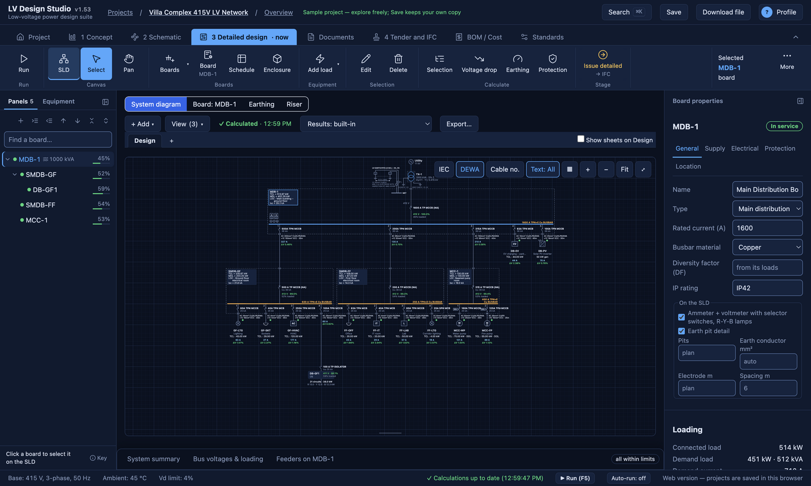
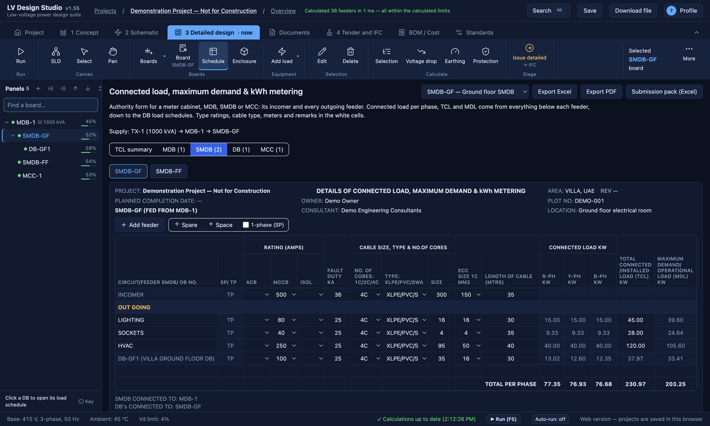
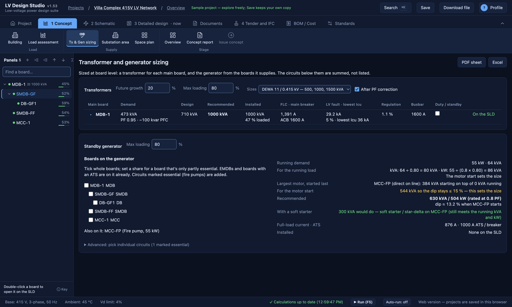
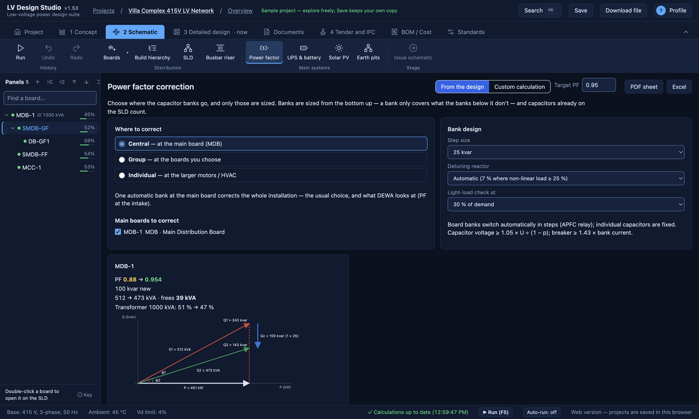
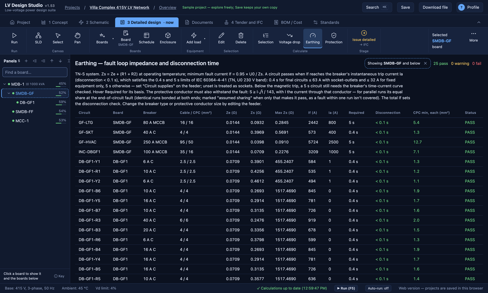
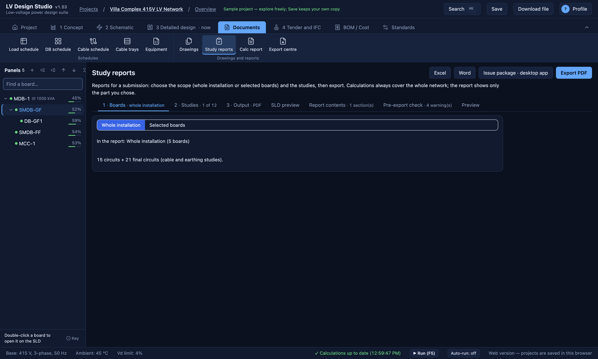
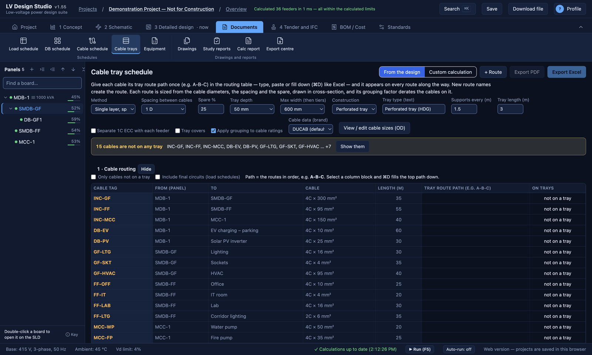
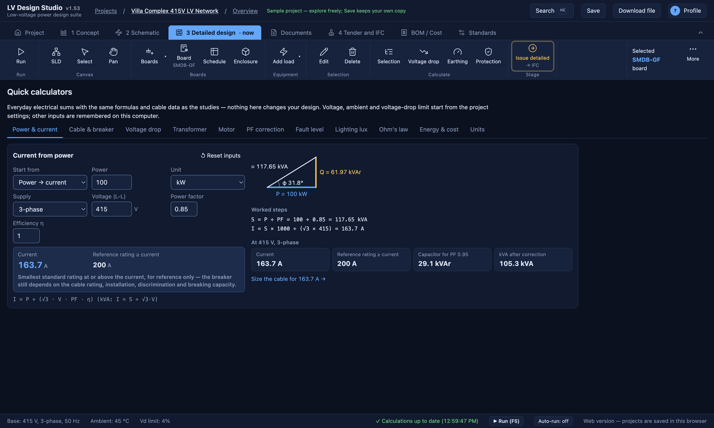
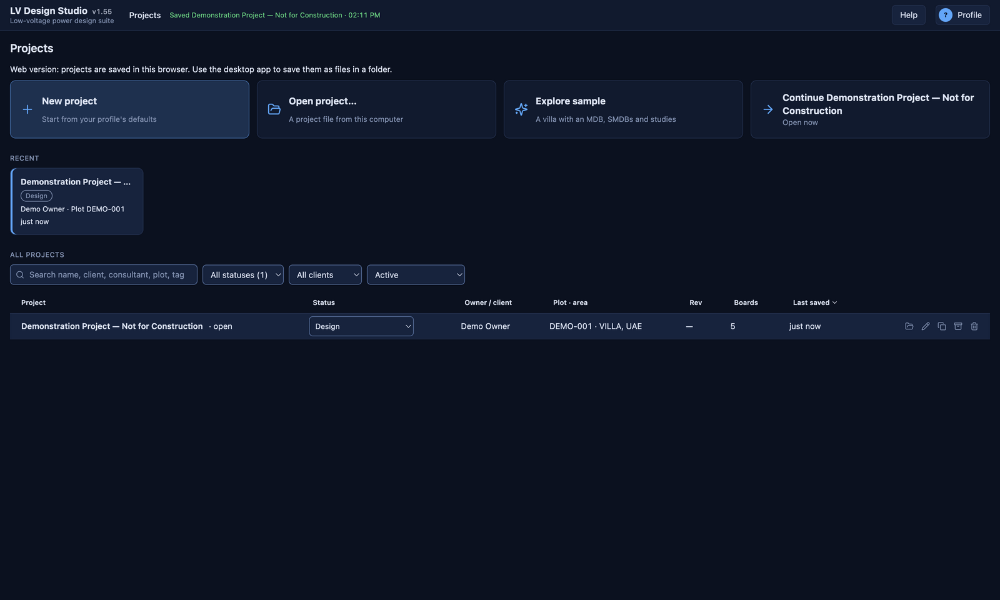

# LV Design Studio

An offline desktop app (Electron) for LV electrical design: single line
diagram, load schedules, cable and breaker sizing, voltage drop, short
circuit, earthing, protection coordination, transformer / generator sizing,
power factor correction, drawings and submission reports. Projects are plain
JSON files, so they sync cleanly through a Google Drive / OneDrive / Dropbox
desktop folder.

**Version 1.46** (see `package.json`). The app is in active use and active
development.

> **Engineering status.** The calculations are first-pass design checks, not
> a substitute for an engineer's verified study. Cable data starts from
> built-in approximate reference values (replace them with manufacturer data in
> `Cables.xlsx`), and fault levels use a simplified IEC 60909-0 method
> (c max = 1.05, cable R at 20 °C, infinite MV source, no KT), not a full
> IEC 60909 study. Nothing in the app
> constitutes approval by DEWA or any other authority. Methods, assumptions and
> limits are in [docs/engineering/calculation-methods.md](docs/engineering/calculation-methods.md).

## Screenshots

The built-in demo project (a 415 V villa complex).

**Single line diagram**: IEC symbols and a legend, the panel tree on the left, the equipment palette, and properties on the right.


**Load schedule**: the DEWA connected load / maximum demand form for the board picked in the panel tree.


**Transformer & generator sizing**: a transformer per MDB (fault level, main breaker, regulation, Apply to SLD), and the generator chosen by board, with the largest motor starting last.


**Power factor correction**: central, group or individual correction. Banks are sized from the bottom up (nothing is corrected twice), with steps and detuning. Add them to the SLD.


**Earthing, filtered from the panel tree**: click SMDB-GF to see only that board and the boards below it.


**Study reports**: choose boards and studies (short circuit, load flow, PFC…) and export a submission PDF or Excel file, with an SLD for each study.


**Cable tray schedule**: route paths (A-B-C), tray sizing with DUCAB cable data, grouping derating, cross-sections and BOQ.


**Quick calculators**: amps, kW/kVA, cable & breaker, voltage drop, transformer and more.


**Projects dashboard**: recent projects, status (Design → Submitted → Approved), search, duplicate.


## Setup

Requires [Node.js](https://nodejs.org) 20.19+ or 22.12+ (CI uses Node 24).

```bash
npm ci
npm run dev
```

This opens the app in an Electron window (with the Vite dev server on
http://localhost:5173). Click **Explore sample** for a worked 415 V villa
complex, or start a new project.

## Saving projects to Google Drive

On first run the app creates `~/LV Design Studio Projects`. Click the
**Folder** button on the ribbon's **Project** tab and point it at a folder
inside your Google Drive desktop-sync folder (e.g.
`~/Google Drive/My Drive/LV Projects`). Every "Save" writes a plain `.json`
file there, which Drive then syncs automatically — no login or API needed
inside the app itself.

## Building an installer

```bash
npm run dist
```

Produces a `.dmg` (mac), `.exe` installer (Windows), or `.AppImage` (Linux)
in `release/`, depending on the platform you build on. `npm run dist:mac`
builds an Apple-silicon `.dmg` only.

## Checks and tests

```bash
npm run typecheck   # TypeScript
npm run lint        # ESLint, no warnings allowed
npm test            # unit tests (Vitest), src/**/*.test.ts
npm run build       # production build
npm run test:pdf    # reports printed through Electron's Chromium (needs Electron's binary); pages compared with tests/pdf/baselines
npm run test:pdf:update  # new layout baselines, after an intended layout change
npm run bench       # calculation performance on large networks
```

The unit tests include hand-calculated reference cases for voltage drop,
short circuit, earth fault loop, maximum demand, power factor correction and
transformer sizing (`src/calc/referenceCalcs.test.ts`). The expected values are
worked out by hand in the test comments, not produced by the code. They check
that the code follows its documented method; they do not certify the method
against a standard. CI (`.github/workflows/ci.yml`) runs all of the above plus a
dependency audit of the shipped packages.

## Database (Excel, synced by Google Drive)

Reusable data lives in Excel workbooks in the `LV Database` folder inside
your projects folder, so Google Drive syncs it across PCs and to anyone
sharing the folder:

| Workbook | Contents | Starts with |
|---|---|---|
| `Loads.xlsx` | Your equipment: name, category, schedule column, power (W), PF, phases, demand factor, starting, manufacturer/model | Empty — user input only |
| `Cables.xlsx` | Size, R at 20 °C, X, current rating, rate per m, manufacturer, cable type, installation method, reference document — used by every calculation | The app's reference values, to replace with manufacturer data |
| `Breakers.xlsx` | Ratings the sizing may choose, Icu, price | Standard ratings |
| `Parameters.xlsx` | Design defaults for new projects (VD limit, ambient, min wires, ELCB mA, ...) | Parameter names, blank values |

The app creates any missing workbook (never overwrites one) and watches the
folder: save a workbook in Excel and the app updates within a second or two.
Library items can be picked for a load schedule's WATT/UNIT column or in the
feeder form; columns linked to a library item follow it when it changes.
Problems (bad rows, missing columns) are listed on the Database screen.

A cable row counts as **manufacturer data** only when it names a
Manufacturer and a Reference document. Reports name every cable size that
still uses reference values, user-entered values without a source, or a
reference value because the size is missing from `Cables.xlsx`. For a final
design, tick **Project settings → Final design: require manufacturer cable
data**: those sizes then become failures in the To do list.

## Calculation engines

The built-in TypeScript engine (`src/calc/`) drives the live UI. Two external
engines can be run on demand from **Simulate → Load flow**, which
shows their results next to the built-in engine's for every feeder:

| Engine | What it adds |
|---|---|
| **OpenDSS** (via OpenDSSDirect.py) | Full load flow, including unbalance from single-phase loads; fault study |
| **pandapower** | Newton-Raphson load flow; IEC 60909 maximum short circuit (cmax = 1.10, transformer KT correction) |

Both run in a small Python helper (`engines/python/lvds_engine.py`) that the
Electron main process starts on demand. Setup:

```bash
pip install opendssdirect.py pandapower
```

The app uses `python` on Windows and `python3` elsewhere; pick a different
interpreter with **Choose Python…** on the comparison screen. The external
engines are optional and need a separate Python setup; treat them as a
cross-check of the built-in engine.

**OpenDSS script export:** *Export OpenDSS (.dss)* (ribbon **More** menu) writes the
network as a self-contained OpenDSS script (load flow + fault study) that
you can open in OpenDSS itself. The modelling assumptions are listed in the
header of the exported file.

## Command line, MCP server and local API

`lvds` uses the app's own calculations without opening the app. It works on
projects in the app's projects folder. Reading and checking never changes a
file; changing a project is described below.

```bash
npm run build:cli
node dist-cli/lvds.mjs help
node dist-cli/lvds.mjs check "My project"      # to-do list; exit code 1 if anything fails
node dist-cli/lvds.mjs panel "My project" SMDB-GF
node dist-cli/lvds.mjs cable --current 120 --length 80 --ambient 45
```

Add `--json` for scripts, `--folder <path>` for another projects folder.

**MCP (for an AI assistant).** `lvds mcp` runs an MCP server on this computer.
Claude Desktop, Claude Code or a free local model (through any MCP client) can
then list projects, read panels and results, run the checks and use the quick
calculations. The app makes no AI calls itself and needs no paid service. For
Claude Code:

```bash
claude mcp add lv-design-studio -- node /path/to/LV-Design-Suit/dist-cli/lvds.mjs mcp
```

For Claude Desktop, add the same command under `mcpServers` in its
`claude_desktop_config.json`:
`{"lv-design-studio": {"command": "node", "args": ["/path/to/LV-Design-Suit/dist-cli/lvds.mjs", "mcp"]}}`.
Through MCP and the API, only files inside the projects folder can be opened.

**Local API.** `lvds serve` (default port 8765) answers on `http://127.0.0.1`
only: `GET /api/tools` lists the tools and their inputs, `GET
/api/tools/run_checks?project=My%20project` or `POST` with a JSON body runs
one.

**Changing a project.** `lvds mcp --write` and `lvds serve --write` also offer
tools that change a project (on the command line they are always there). They
show a preview unless called with `mode` apply / propose (`--apply` /
`--propose` on the command line):

- **Value changes are only proposed.** `size_circuits` (the app's own cable and
  breaker selection) and `propose_changes` add a modification record (MOD-00x)
  to **Reports → Changes**. The engineer accepts it with their name and applies
  it in the app, as one undo step. The tools never accept anything and never
  change the values themselves.
- **Structure changes** (`add_panel`, `add_circuit`, `move_panel`,
  `rename_panels`, `copy_panel`) change the file after the preview. New panels
  and circuits are sized by the app's selection.
- Every change keeps the previous version in `.lvds-agent/` in the projects
  folder and is logged (`list_changes`); `undo_change` puts it back.
- Nothing is written while the project has unsaved changes open in the app, or
  over a file that changed in the meantime. Deleting and exporting are not
  offered.

```bash
node dist-cli/lvds.mjs size "My project"            # preview the sizing proposal
node dist-cli/lvds.mjs size "My project" --propose  # add it to Reports → Changes
node dist-cli/lvds.mjs add-panel "My project" --kind SMDB --id SMDB-L3 --fedFrom MDB-1 --lengthM 45 --apply
node dist-cli/lvds.mjs undo "My project" --apply
```

## What it does

- **Design**: boards and circuits in a multi-level hierarchy, load schedules
  (DEWA connected load / maximum demand form), building and room data,
  feeder presets and an Excel-based equipment library.
- **Calculations** (`src/calc/`, run on every change or with F5): design
  current, derated cable rating (ambient and grouping), voltage drop per
  circuit and cumulative from the source, overload protection Ib ≤ In ≤ Iz,
  fault levels at each busbar and cable end, earth fault loop and
  disconnection time, protective conductor adiabatic check, selectivity,
  transformer and generator sizing, power factor correction, busbar risers,
  UPS and solar PV.
- **Checks**: a To do list on the dashboard with everything that fails or
  needs checking, including invalid inputs (for example a zero breaker rating
  or a power factor of 0), supply loops, inputs outside a method's range and
  unverified cable data. Project readiness stages track setup, design,
  calculation, issues, drawings and issue.
- **Drawings and documents**: single line diagram, board sheets, earthing
  and riser drawings, DB / cable / equipment schedules, BOQ, study reports
  (PDF and Word), calculation report, Excel exports, revisions and
  transmittals.
- **Projects**: JSON files with backup (`.bak`), recovery copies of unsaved
  work, trash (30 days), conflict detection for synced folders, and a file
  version with migration of older files. A file without the structure the app
  needs is refused when opened, with a message saying why.

## Limitations

- **Cable data**: the built-in values (Cu/XLPE/SWA multicore, free air,
  30 °C) are approximate. Each circuit has an IEC 60364-5-52 installation
  method (E free air / tray unless set; C, B1, B2, A1, A2, D1, D2). Ratings for
  methods other than E come from the `Rating A1 … D2` columns of `Cables.xlsx`;
  the built-in reference has none yet, so a circuit on such a method shows
  DATA REQUIRED until its rating is entered. Grouping with other circuits is
  counted only on cable tray routes; otherwise a circuit's own parallel runs.
- **Ambient temperature**: the derating table covers 25–70 °C. Above 70 °C the
  result is flagged as a failure, below 25 °C as a warning.
- **Short circuit**: maximum currents use c max = 1.05 (LV systems with a
  +6 % tolerance; IEC 60909-0 gives 1.10 for +10 %) and cable R at 20 °C. The
  MV network is treated as infinite, the transformer correction factor KT is
  not applied and motor contribution is ignored. Use the pandapower comparison
  or a full study for final breaking-capacity checks.
- **Voltage drop**: first-order formulas summed along the radial path; the
  incomer to a sub-board uses per-phase P and Q but is not an unbalanced load
  flow.
- **Selectivity** is current-based only; confirm with the breaker
  manufacturer's selectivity tables. Breaker curves are generic.
- **Web version** (browser, no Electron): projects stay in the browser; the
  Excel database, full PDF printing and the external engines need the desktop
  app.

## Licence

LV Design Studio is **source-available** under the [PolyForm Shield License 1.0.0](LICENSE.md): you can use it — including for paid engineering design work — and read and change the code, but you may not sell it, offer it as a paid service, or build a competing product from it. The name "LV Design Studio" and its logo are not licensed. See [NOTICE.md](NOTICE.md).
